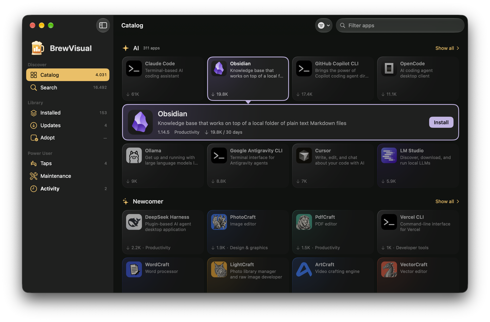
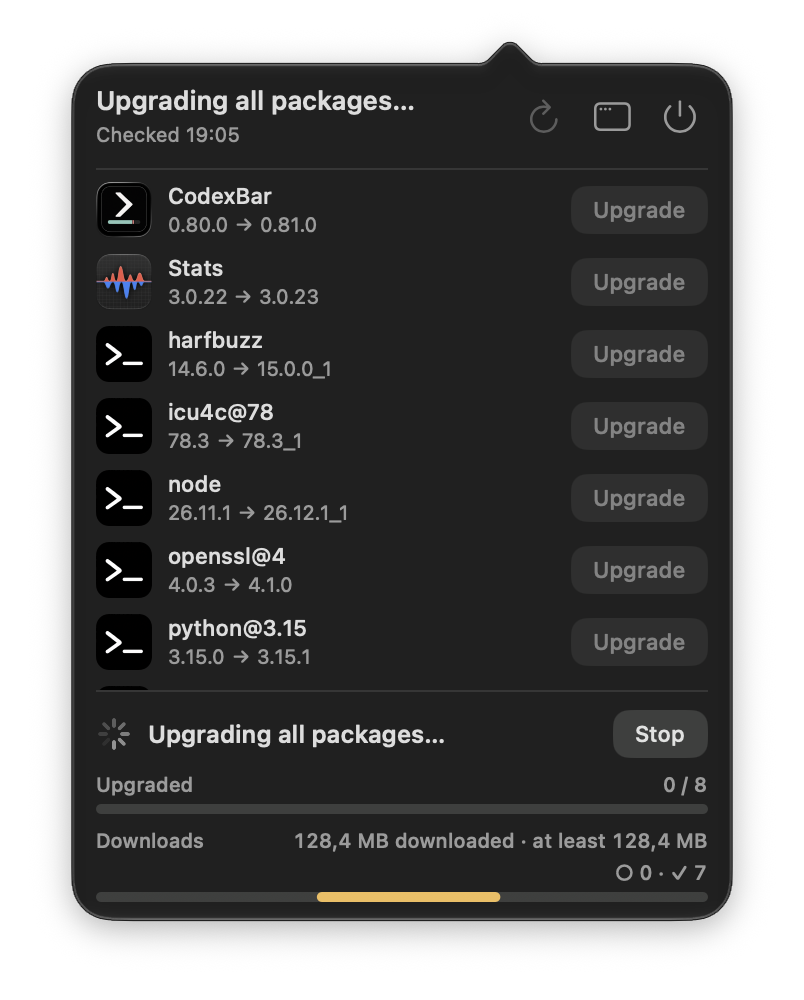

# BrewVisual

A native macOS interface for managing Homebrew formulae, casks, and taps.

BrewVisual is available in English and German. Published downloads are signed with an Apple Developer ID certificate and notarized by Apple.

## Screenshots



*Dashboard in BrewVisual 0.6.0 (English interface).*


*Menu bar icon in BrewVisual 0.6.0 with one available update.*



*Menu bar update overlay in BrewVisual 0.6.0 (English interface).*

## Features

- Browse installed formulae and casks, discover packages, and manage taps.
- Browse and search packages from an installed third-party tap, with package counts and repository links in a dedicated detail pane.
- Show GitHub owner avatars for supported taps, with cached images and fallback icons.
- See available updates, library counts, and recent command activity together on the dashboard.
- Access update checks and Upgrade all together in the dashboard's update card.
- Install, uninstall, and upgrade packages from the main window.
- Pin and unpin installed formulae and casks to control package upgrades.
- View available updates in the menu bar and upgrade an individual package or all available packages.
- Open installed Cask apps from the package inspector or context menu.
- Update the Homebrew-installed BrewVisual app with a version-specific changelog and automatic restart.
- Inspect package versions, dependencies, caveats, and project links.
- Follow command and download progress, and review technical output in the command log.
- Refresh with Command-R or the contextual button. Updates checks sources for new versions; package lists reload installed information. Adopt Apps provides Scan again.
- Run Homebrew diagnostics and preview cleanup candidates before confirming cleanup.
- Open Settings from the app menu or Command-comma, with a native category toolbar in a fixed-size window.
- Bring supported existing apps under Homebrew management with Adopt Apps.
- Review estimated storage use and cleanup potential in Maintenance.
- Choose Small, Medium, or Large menu bar badge sizes in Settings → General.
- Display additional CaskFlow icons when local application icons are unavailable, including supported package variants.

## Requirements

- macOS 27 or later
- Apple Silicon (arm64)
- [Homebrew](https://brew.sh) for package management; first-run setup can install it if needed

Homebrew is required for package management. If it is missing during first-run setup, BrewVisual can run the official installer, show progress and output, request administrator access when needed, verify the installation, and configure supported shells for new terminal windows. New users see a three-step introduction covering Homebrew, permissions, and optional login startup. Homebrew must be available before setup can finish. Existing users keep their preferences and can open the guide through **Review introduction** in **Settings → Permissions**.

## Install with Homebrew

```sh
brew install --cask felix-lorenz/tap/brewvisual
```

The [Homebrew tap](https://github.com/felix-lorenz/homebrew-tap) downloads a versioned release archive and verifies its SHA-256 checksum.

## Update BrewVisual

When the Homebrew-installed BrewVisual app appears in the update list, choose **Update and restart…** to review the target version and changelog before confirming. BrewVisual closes while its separate updater runs the Homebrew upgrade, then reopens in the previous main-window or menu-bar state. **Upgrade all** updates other packages first and offers BrewVisual as a separate confirmation afterward.

You can also update from Terminal. Quit BrewVisual when no Homebrew command is running, then run:

```sh
brew update
brew upgrade --cask felix-lorenz/tap/brewvisual
```

## Direct download

Download the ZIP from the [latest release](https://github.com/felix-lorenz/brewvisual-releases/releases/latest). The release notes include its SHA-256 checksum.

Extract the ZIP and move `BrewVisual.app` to Applications. To update a direct installation, quit BrewVisual and replace the existing app with the app from the latest ZIP.

## Package checks and upgrades

By default, BrewVisual checks for updates at launch after any required introduction is complete, and every six hours while it is running. These checks run `brew update` to refresh Homebrew and package metadata; they do not upgrade installed formulae or casks.

In **Settings → General**, launch checks and periodic checks can be enabled independently. The periodic interval accepts whole hours from 1 to 24. You start package installation, removal, and upgrades explicitly, and **Check now** in the menu bar runs an on-demand check.

## Start at login

Login startup is optional and off for new users. After installing BrewVisual in Applications, enable **Start at login** in the introduction or **Settings → Permissions**. Existing login preferences are preserved. If macOS requires approval, use **Open Login Items** in Settings.

At login, BrewVisual opens in the menu bar without a main window or Dock icon when Homebrew is available. If Homebrew is missing, open the app manually to follow its installation guidance. Once setup is complete, opening BrewVisual from Finder or Spotlight, or choosing **Open BrewVisual** in the menu bar, shows the main window and Dock icon. Closing all app windows returns it to menu-bar-only operation.

## App Management and administrator access

Before an action that changes an app cask, BrewVisual may show App Management guidance. macOS may require access to install, update, or remove apps. While the App Management card is visible, BrewVisual estimates access using temporary write tests in suitable application bundles. Granted, Not Granted, and Unknown describe this evidence; they do not confirm the global macOS permission setting. In **Settings → Permissions**, choose **Open App Management** to open **System Settings → Privacy & Security → App Management** and enable BrewVisual. If it is missing, add it with **+**. After a Homebrew access failure, BrewVisual keeps the action and log available for review and offers an explicit retry after the package list is refreshed.

If Homebrew needs `sudo` for a protected installation step, BrewVisual presents a secure administrator password prompt naming the app, action, and affected packages. The password is passed only to `sudo`; it is not stored or included in the command log.

The self-update helper has its own signed identity, **BrewVisual Updater**. If an App Management access failure occurs during a self-update, review access for this helper separately; the main app's access does not establish the helper's authorization.

## Support

Report bugs or request features through [GitHub Issues](https://github.com/felix-lorenz/brewvisual-releases/issues). Include your BrewVisual, macOS, and Homebrew versions, steps to reproduce the problem, and relevant command output. Remove personal information from screenshots and logs before sharing them.

You can also support BrewVisual's development on [Ko-fi](https://ko-fi.com/felixlorenz). The sidebar's **Support me on Ko-fi** link opens this page in your browser.

## About this repository

This public repository provides product documentation, screenshots, release notes, and distribution archives. The source repository is private.

BrewVisual is an independent app and is not affiliated with or endorsed by the Homebrew project.
